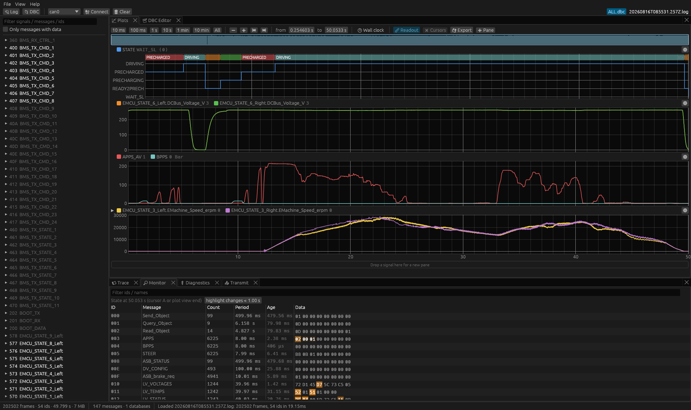

# canstudio

A self-contained CAN bus tool suite in Rust + egui: DBC editor, candump log
viewer, signal plotting, live SocketCAN, bus diagnostics and transmit.



*A 50 s drive cycle from a candump log (200 k frames, loaded in 17 ms): the
vehicle state machine with labelled value-table strips, the HV bus
precharging, pedal inputs, both motor speeds, and the Monitor tab highlighting
the bytes that just changed.*

```
cargo run --release -p canstudio -- TeR_DATABASES/ALL.dbc logs/some.log \
    --plot TER_STATUS.STATE --plot InverterInfo.leftMotorTemp,InverterInfo.rightMotorTemp
cargo run --release -p canstudio -- ALL.dbc --connect can0
```

Files given on the command line or dropped on the window open by extension
(`.dbc` → database, anything else → candump log). `--plot` creates one pane per
flag; `--connect` attaches to a SocketCAN interface.

## Features

**Plots**
- Stacked panes that share one time axis and cursor. Drag signals onto a pane from the tree, or click them to add to the active pane (▶).
- Min/max decimation keeps every peak visible and stays fluid with millions of samples.
- Value tables (`VAL_`):
  - state strips drawn over the top of the graph, with labels
  - enum-named Y ticks when a pane shows a single enum signal
  - stepped rendering
- Time navigation:
  - window presets (10 ms … 10 min, All) and an exact from/to entry
  - zoom/pan, box zoom (right-drag), jump to start/end
  - zoom to the A–B cursors
  - wall-clock time axis
  - recording overview strip (click or drag to navigate)
  - live **Follow** mode
- Autoscale modes: visible data, DBC min/max, or manual. XY mode.
- Cursors: click places A, Shift+click places B. The readout shows values at A and B, Δ, Δt, 1/Δt, and min/max/mean between the cursors.
- Export:
  - plotted signals to CSV, wide (sample & hold) or long format
  - the frames in a range back to a candump log (trimming)

**Trace / Monitor**
- Virtualised frame trace of millions of frames. Filters by id or name, or errors only. Shows decoded summaries; double-clicking a row jumps the plots to it.
- Monitor is a cansniffer-style view: one row per id, with changed bytes highlighted (fading). It shows live state, or the state at cursor A when browsing a log.

**Diagnostics**
- Bus load, from the exact bit-stuffed length of each classic frame. Configurable nominal and FD bitrates.
- Load timeline.
- Error-frame classes, decoded from the `CAN_ERR_*` bits.
- Per-id statistics: count, rate, mean/min/max period, jitter, length, load share.
- Health checks against the DBC: unknown ids, length mismatch, period deviation from `GenMsgCycleTime`, silent ids (timeouts). Also lists cyclic DBC messages that were never seen.
- Scope: recent window, plot view, or everything.

**Transmit**
- Raw frames, or DBC messages edited as physical values, with combo boxes for enum signals. Multiplexed signals follow the switch value.
- Classic or FD (BRS).
- Send once, or periodically from a dedicated scheduler thread. The period defaults to `GenMsgCycleTime`.

**DBC editor** (evolved from [rsdbc](https://github.com/Ozuba/rsdbc))
- Nodes, messages, signals, value tables, comments.
- Typed attributes (`BA_DEF_`/`BA_DEF_DEF_`/`BA_`) with a definitions editor.
- Float signals (`SIG_VALTYPE_`), extended multiplexing (`m1M`, `SG_MUL_VAL_`), CAN-FD lengths up to 64 bytes.
- Renaming a node, signal or id updates every reference to it.
- Clickable bit layout (red outline marks overlapping signals). Undo/redo (Ctrl+Z / Ctrl+Y).
- Validation: overlaps, out-of-range bits, duplicate ids and names, float sizes, broken mux.
- Decode preview: the latest frame of the selected message, decoded with the definition as currently edited.
- Edits re-decode the loaded data immediately.

**Live (Linux)**
- SocketCAN with FD frames, error frames and kernel receive timestamps.
- Recording to a candump log.
- Pause: freezes the views while capture continues.

Layout, panes, transmit jobs and opened databases persist between runs.

## Keys

| Context | Keys |
|---|---|
| Plots | Drag: pan · Scroll: zoom · Right-drag: box zoom · Click / Shift+click: cursors A / B · F: fit · ←/→: pan · +/−: zoom · Home/End · Space: follow (live) |
| Global | Ctrl+O: open log · Ctrl+D: open DBC |
| DBC editor | Ctrl+S: save · Ctrl+Z / Ctrl+Y: undo / redo |

## Layout

```
crates/dbc      model, lossless parser/writer, codec (no dependencies besides serde)
crates/canbus   frames, candump IO, columnar FrameStore, decoded series cache,
                statistics, SocketCAN capture/transmit/scheduler — no UI
app             eframe application (egui 0.36, egui_plot, egui_dock)
```

- **Frames** are stored as columns (about 30 B/frame) with an index per id. Time is kept relative to a `t0`, so `f64` keeps sub-µs precision.
- **Loading** memory-maps the log and parses newline-aligned chunks in parallel. A 5.2 M-line log loads in about 0.2 s.
- **Signals** are decoded lazily, one at a time, and extended incrementally while live.

## Testing

```
cargo test --workspace
```

The test suite covers:
- **DBC round-trips:** parse → write → parse must reproduce an identical model, for the 82-file cantools corpus plus `TeR_DATABASES`.
- **Codec vectors:** Intel/Motorola, signed, float, mux, extended mux, FD.
- **Log format:** candump edge cases.
- **Store, statistics, decimation.**

The codec was also cross-checked against `cantools decode`: zero mismatches over about 50k values, including Motorola and float signals.

Live tests need a virtual CAN interface. Root is not required:

```
unshare -rnm sh -c 'mount -t sysfs sysfs /sys && ip link add vcan0 type vcan &&
  ip link set vcan0 mtu 72 up && cargo test -p canbus --test vcan'
```

Inside the same namespace you can replay a log with `canplayer -I log vcan0=can0` and run the app with `--connect vcan0`.

Building requires Rust 1.95+. `rust-toolchain.toml` pins a suitable toolchain.
