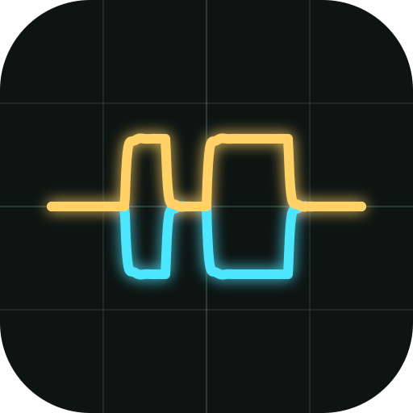

<div align="center">



<h1>canstudio</h1>

<p><b>A fast, self-contained CAN bus workbench in Rust.</b><br>
DBC editor · candump log viewer · signal plotting · live SocketCAN · bus diagnostics · transmit</p>

<p>


</p>

<p><a href="#install">Install</a> · <a href="#quick-start">Quick start</a> · <a href="#features">Features</a> · <a href="#keys">Keys</a> · <a href="#architecture">Architecture</a> · <a href="#testing">Testing</a></p>

<br>


<sub>A 50 s drive cycle from a candump log (200 k frames, loaded in 17 ms): the vehicle state machine with
labelled value-table strips, the HV bus precharging, pedal inputs, both motor speeds, and the Monitor
highlighting the bytes that just changed.</sub>

</div>

## Install

Linux builds for **x86_64** and **aarch64** are on the
[Releases](https://github.com/Ozuba/canstudio/releases) page. They need glibc 2.35 or newer
(Ubuntu 22.04+, Debian 12+, Fedora 36+).

| Package | How |
|---|---|
| `.deb` | `sudo apt install ./canstudio_<version>_amd64.deb`. Adds a menu entry and lets you open `.dbc` files with canstudio. |
| `.AppImage` | `chmod +x canstudio_*.AppImage && ./canstudio_*.AppImage`. A single file with no install. |
| `.tar.gz` | The bare binary. Extract it and run `./canstudio`. |

To build from source instead: `cargo build --release -p canstudio`.

## Quick start

```sh
# open a database and a log, with two plot panes ready
cargo run --release -p canstudio -- TeR_DATABASES/ALL.dbc logs/some.log \
    --plot TER_STATUS.STATE \
    --plot InverterInfo.leftMotorTemp,InverterInfo.rightMotorTemp

# watch a live bus
cargo run --release -p canstudio -- ALL.dbc --connect can0
```

Files on the command line, or dropped on the window, open by extension: `.dbc` is a database and anything
else a candump log. `--plot` creates one pane per flag; `--connect` attaches to a SocketCAN interface.
Building needs Rust 1.95+, and `rust-toolchain.toml` pins a suitable toolchain.

## Features

<table>
<tr>
<td width="33%" valign="top"><b>📈 Plots</b><br>Stacked panes on one time axis, value-table state strips, cursors with statistics, and millions of samples at full speed.</td>
<td width="33%" valign="top"><b>📝 DBC editor</b><br>Lossless round-trip, typed attributes, float and extended-mux signals, a drag-and-drop bit layout, and undo/redo.</td>
<td width="33%" valign="top"><b>🔌 Live bus</b><br>SocketCAN with CAN-FD, error frames and kernel timestamps. Record, pause, follow.</td>
</tr>
<tr>
<td width="33%" valign="top"><b>🔎 Trace &amp; Monitor</b><br>A virtualised trace of every frame, plus a cansniffer-style monitor with changed-byte highlighting.</td>
<td width="33%" valign="top"><b>⚕ Diagnostics</b><br>Exact bus load, per-id timing and jitter, error classes, and health checks against the DBC.</td>
<td width="33%" valign="top"><b>📤 Transmit</b><br>Raw or DBC-encoded frames, edited as physical values, sent once or periodically.</td>
</tr>
</table>

<br>

<details open>
<summary><b>Plots</b></summary>

- Stacked panes that share one time axis and cursor. Drag signals onto a pane from the tree, or click them to add to the active pane (▶).
- Min/max decimation keeps every peak visible and stays fluid with millions of samples.
- Value tables (`VAL_`):
  - state strips drawn over the top of the graph, with labels
  - enum-named Y ticks when a pane shows a single enum signal
  - stepped rendering
- Time navigation:
  - window presets (10 ms … 10 min, All) and an exact from/to entry
  - zoom/pan, box zoom (right-drag), jump to start/end
  - zoom to the A–B cursors
  - wall-clock time axis
  - recording overview strip (click or drag to navigate)
  - live **Follow** mode: zooming keeps following, panning stops it
- Live: each line is held up to "now" with its current value tagged at the right edge, the Y range eases instead of jumping, and signals that stop updating are marked stale.
- Autoscale modes: visible data, DBC min/max, or manual. XY mode.
- Cursors: click places A, Shift+click places B. The readout shows values at A and B, Δ, Δt, 1/Δt, and min/max/mean between the cursors.
- Export:
  - plotted signals to CSV, wide (sample & hold) or long format
  - the frames in a range back to a candump log (trimming)

</details>

<details>
<summary><b>Trace / Monitor</b></summary>

- Virtualised frame trace of millions of frames. Filters by id or name, or errors only. Shows decoded summaries; double-clicking a row jumps the plots to it.
- Monitor is a cansniffer-style view: one row per id, with changed bytes highlighted (fading). It shows live state, or the state at cursor A when browsing a log.

</details>

<details>
<summary><b>Diagnostics</b></summary>

- Bus load, from the exact bit-stuffed length of each classic frame. Configurable nominal and FD bitrates.
- Load timeline.
- Error-frame classes, decoded from the `CAN_ERR_*` bits.
- Per-id statistics: count, rate, mean/min/max period, jitter, length, load share.
- Health checks against the DBC: unknown ids, length mismatch, period deviation from `GenMsgCycleTime`, silent ids (timeouts). Also lists cyclic DBC messages that were never seen.
- Scope: recent window, plot view, or everything.

</details>

<details>
<summary><b>Transmit</b></summary>

- Raw frames, or DBC messages edited as physical values, with combo boxes for enum signals. Multiplexed signals follow the switch value.
- Classic or FD (BRS).
- Send once, or periodically from a dedicated scheduler thread. The period defaults to `GenMsgCycleTime`.

</details>

<details>
<summary><b>DBC editor</b> (evolved from <a href="https://github.com/Ozuba/rsdbc">rsdbc</a>)</summary>

- Nodes, messages, signals, value tables, comments.
- Typed attributes (`BA_DEF_`/`BA_DEF_DEF_`/`BA_`) with a definitions editor.
- Float signals (`SIG_VALTYPE_`), extended multiplexing (`m1M`, `SG_MUL_VAL_`), CAN-FD lengths up to 64 bytes.
- Renaming a node, signal or id updates every reference to it.
- Bit layout:
  - drag a signal to move it, for both Intel and Motorola byte orders
  - drag across free bits to create a new signal
  - arrows run from MSB to LSB
  - a red outline marks overlapping signals
- Undo/redo (Ctrl+Z / Ctrl+Y).
- Validation: overlaps, out-of-range bits, duplicate ids and names, float sizes, broken mux.
- Decode preview: the latest frame of the selected message, decoded with the definition as currently edited.
- Edits re-decode the loaded data immediately.

</details>

<details>
<summary><b>Live (Linux)</b></summary>

- SocketCAN with FD frames, error frames and kernel receive timestamps.
- Recording to a candump log.
- Pause: freezes the views while capture continues.

</details>

Layout, panes, transmit jobs and opened databases persist between runs.

## Keys

| Context | Keys |
|---|---|
| Plots | Wheel: zoom time (keeps Follow) · Shift+wheel / drag: pan · Ctrl+wheel: zoom both axes · Right-drag: box zoom · Click / Shift+click: cursors A / B · F: fit · ←/→: pan · +/−: zoom · Home/End · Space: follow (live) |
| Global | Ctrl+O: open log · Ctrl+D: open DBC |
| DBC editor | Ctrl+S: save · Ctrl+Z / Ctrl+Y: undo / redo |

## Architecture

```
crates/dbc      model, lossless parser/writer, codec (no dependencies besides serde)
crates/canbus   frames, candump IO, columnar FrameStore, decoded series cache,
                statistics, SocketCAN capture/transmit/scheduler — no UI
app             eframe application (egui 0.36, egui_plot, egui_dock)
```

- **Frames** are stored as columns (about 30 B/frame) with an index per id. Time is kept relative to a `t0`, so `f64` keeps sub-µs precision.
- **Loading** memory-maps the log and parses newline-aligned chunks in parallel. A 5.2 M-line log loads in about 0.2 s.
- **Signals** are decoded lazily, one at a time, and extended incrementally while live.

## Testing

```sh
cargo test --workspace
```

The test suite covers:
- **DBC round-trips:** parse → write → parse must reproduce an identical model, for the 82-file cantools corpus plus `TeR_DATABASES`.
- **Codec vectors:** Intel/Motorola, signed, float, mux, extended mux, FD.
- **Log format:** candump edge cases.
- **Store, statistics, decimation, bit-layout moves.**

The codec was also cross-checked against `cantools decode`: zero mismatches over about 50k values, including Motorola and float signals.

Live tests need a virtual CAN interface. Root is not required:

```sh
unshare -rnm sh -c 'mount -t sysfs sysfs /sys && ip link add vcan0 type vcan &&
  ip link set vcan0 mtu 72 up && cargo test -p canbus --test vcan'
```

Inside the same namespace you can replay a log with `canplayer -I log vcan0=can0` and run the app with `--connect vcan0`.

## Releasing

1. Bump `version` in the root `Cargo.toml`.
2. Commit, then tag and push: `git tag v0.2.0 && git push origin v0.2.0`.
3. The [Release workflow](.github/workflows/release.yml) tests, builds the `.deb`, AppImage and `.tar.gz` for
   x86_64 and aarch64, and publishes them with checksums and generated release notes.

To build the same packages locally: `cargo install cargo-packager --locked && cargo packager --release -p canstudio`.
The output goes to `target/packages/`.

<div align="center"><br></div>
